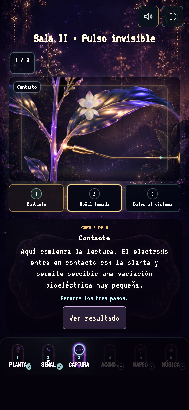
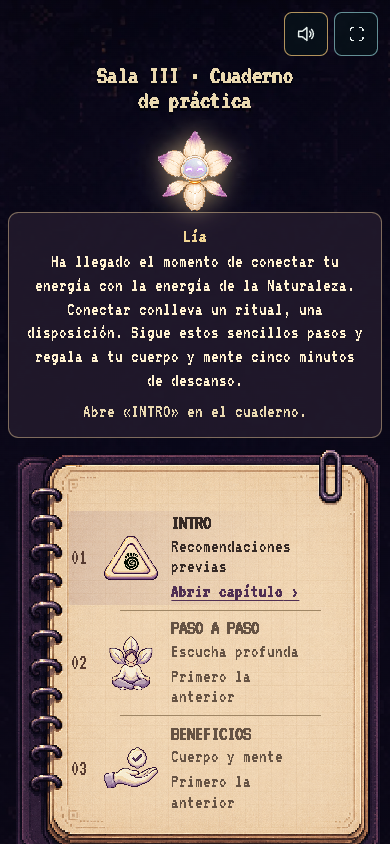

# GVO · Guía Virtual OKÚA

GVO acompaña la visita al Jardín Biosonoro de OKÚA. Lía guía al visitante desde el primer encuentro con una planta hasta la escucha de una composición. Cada sala propone una forma distinta de mirar, tocar o escuchar. La guía se abre en el navegador del teléfono, en español o en inglés. El jardín sirve las imágenes, las tipografías y el sonido desde su propia red.

**Edición 1.2.0 · 25 de noviembre de 2026.** José David aprobó esta versión para entregar al escritor. Siguen abiertas la devolución editorial y la observación de primeras visitas autónomas. La última instalación documentada en campo corresponde a 1.1.3. [Acta de la edición](docs/releases/GVO_1.2.0.md) · [Estado de campo](docs/releases/GVO_1.1.3.md)

> **Derechos y permisos.** Para reutilizar el código o los materiales propios de GVO, solicita autorización previa al proyecto OKÚA. Esto incluye la marca, Lía, los textos, las ilustraciones y los materiales sonoros. Las dependencias y tipografías de terceros conservan sus respectivas licencias. Puedes iniciar la solicitud indicando el material y el uso previsto. [Condiciones de uso](LICENSE.md) · [Solicitar permiso a OKÚA](https://github.com/okuajardinbiosonoro-art/gvo-guia-virtual-okua/issues/new)

## La visita

En la entrada, Lía riega una planta mientras se prepara la Portada. El visitante elige idioma y volumen, conoce a Lía y abre el primer portal. Al terminar cada una de las primeras cuatro salas, escanea el QR físico de la siguiente desde la propia guía. El progreso se conserva en el navegador para poder detenerse y retomar el recorrido.

| Etapa | Qué encuentra el visitante |
| --- | --- |
| I · Raíz | Explora una planta a través de la relación, la percepción y la mediación. Aquí aprende a utilizar el primer QR. |
| II · Pulso invisible | Sigue la señal desde la planta hasta la música. Puede ver la onda, recorrer la captura de datos y escuchar cómo cambian las relaciones de mapeo. |
| III · Cuaderno de práctica | Abre la introducción, sigue la práctica paso a paso y consulta sus beneficios en las hojas del cuaderno. |
| IV · Sistema biosonoro | Conoce las seis piezas del sistema y pone a prueba su comprensión al ordenarlas sobre la mesa. |
| V · OKÚA, arte sensorial | Responde cuatro preguntas. Cuatro aciertos en una ronda dan acceso al premio y hay hasta tres reintentos completos. |
| Mirador | Revisa las salas y puede llevarse una foto con Lía. La foto se compone en el dispositivo y admite el marco Jardín o, durante la temporada, Navidad. |

<p>
  
  
</p>

## Para el escritor

La edición para Windows incorpora el recorrido en ambos idiomas, los 16 audios locales y el editor v4. Extrae el ZIP completo, abre `INICIAR_GVO.cmd` y elige una escena e idioma. **Guardar en PC** conserva las propuestas. **Exportar todo (.ZIP)** genera el archivo que se devuelve al equipo. [Guía de la revisión](docs/releases/GVO_1.2.0.md#revisión-del-escritor)

## Para desarrollo autorizado

En una copia del repositorio, con Git, Node.js 22.14 o compatible y npm:

```powershell
npm ci
npm run dev
```

Abre la dirección que indique Vite. El certificado que genera el entorno de desarrollo es para el laboratorio. Para validar los cambios y generar la aplicación estática:

```powershell
npm run lint
npm test
npm run build
```

El directorio `dist/` contiene la compilación. Para operar en el jardín, consulta el procedimiento de campo y su versión activa antes de actualizar un equipo. [Handoff de campo](docs/field/FIELD_PC_HANDOFF.md)

## Documentación

- [Estado del proyecto](docs/status/CURRENT_STATE.md) y [registro de la edición 1.2.0](docs/releases/GVO_1.2.0.md).
- [Arquitectura](docs/05_ARQUITECTURA_TECNICA.md), [reglas de producto](docs/01_REGLAS_NO_NEGOCIABLES.md) y [política de recursos visuales](docs/process/POLITICA_ASSETS_UTILIZADOS_RUNTIME.md).
- [Flujo entre estaciones](docs/02_FLUJO_QR_Y_ESTACIONES.md) y [cuatro QR imprimibles](docs/assets/qr/interstation/README.md).
- [Índice de documentación](docs/README.md) y [criterios de la revisión editorial](docs/tickets/GVO_EDITORIAL_20261122.md).
